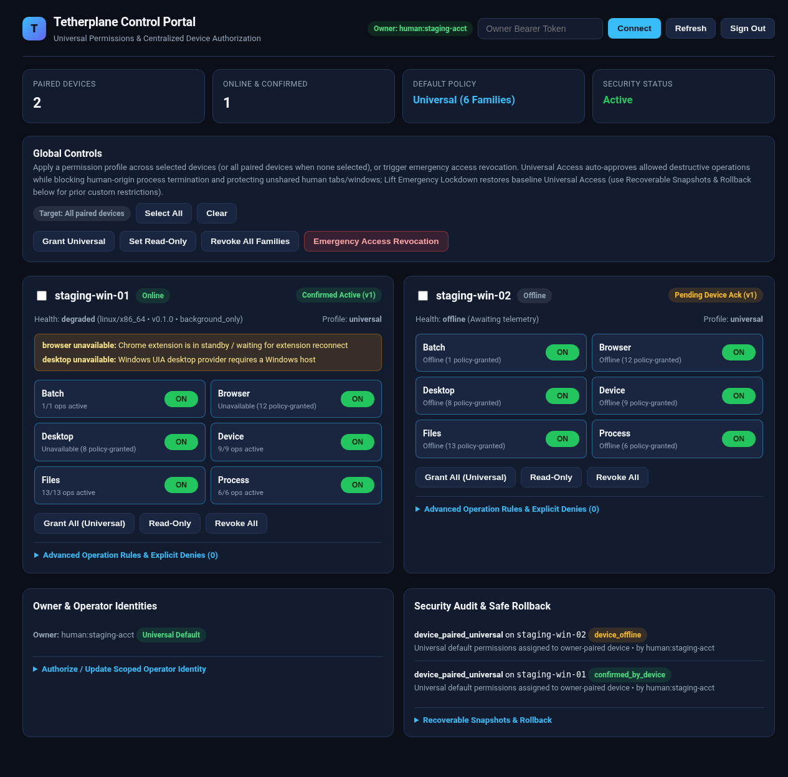
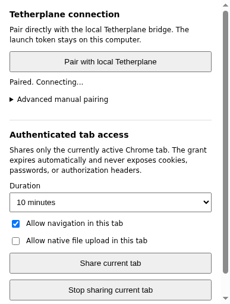
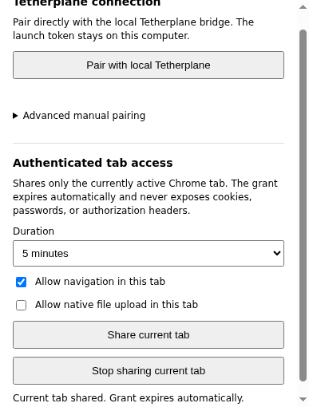
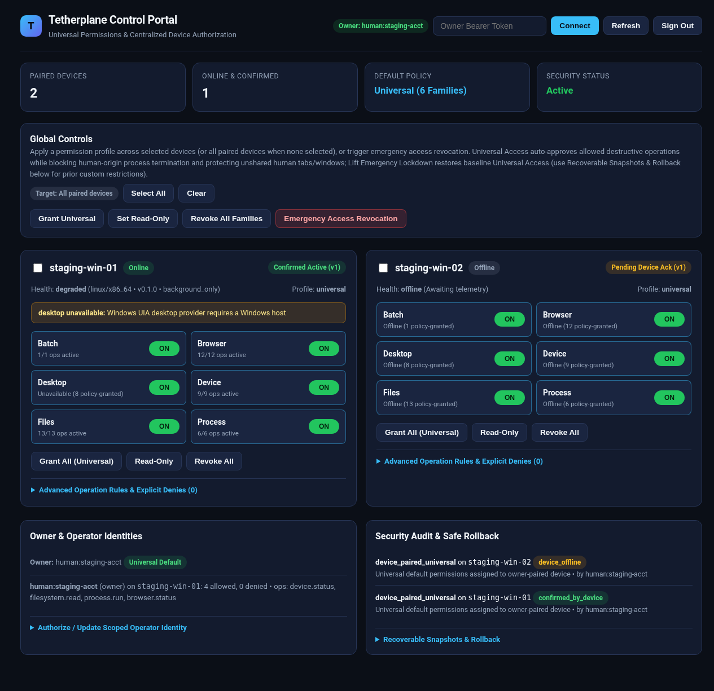
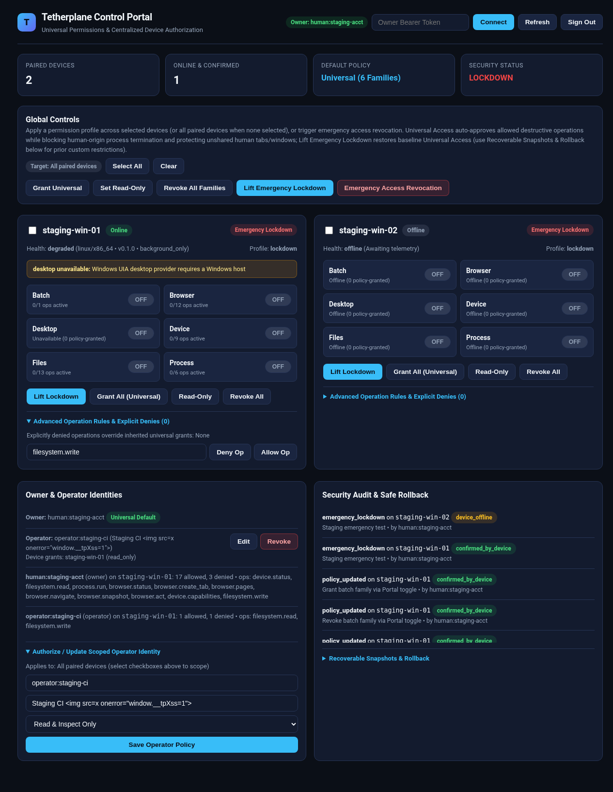
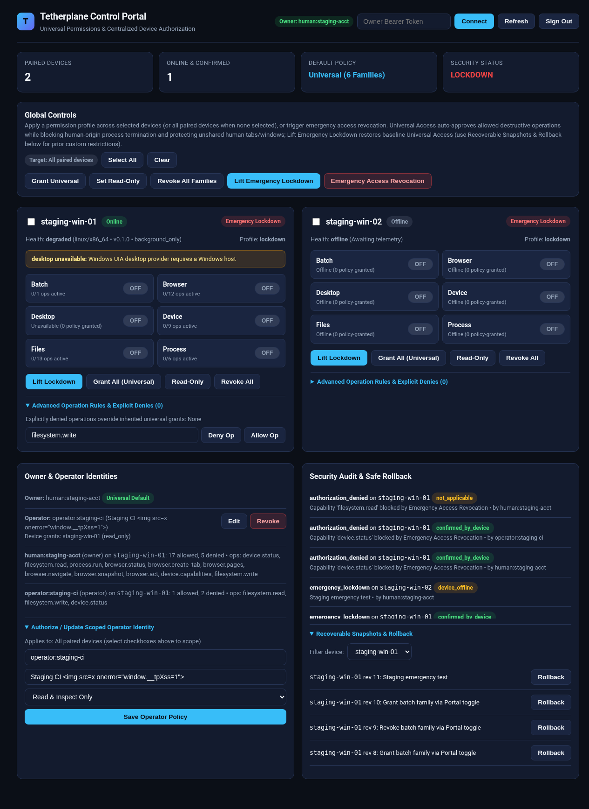
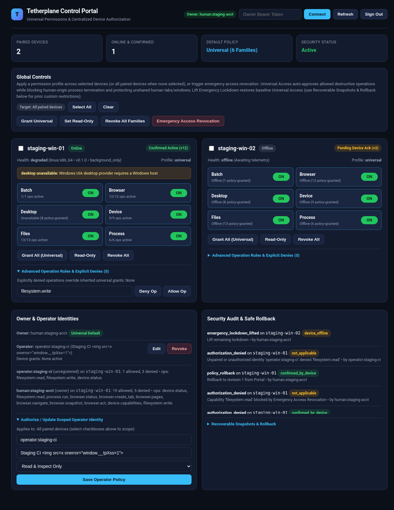
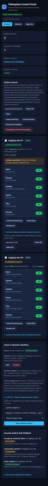
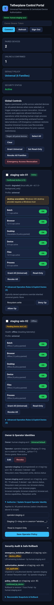
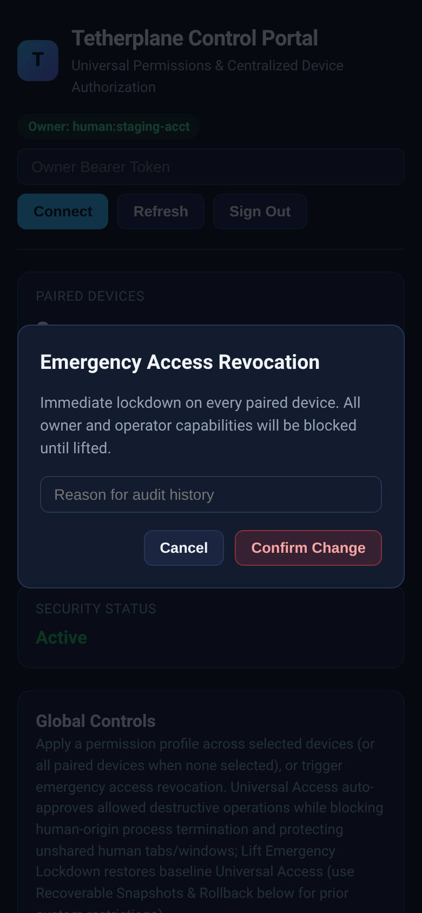

# Tetherplane — Sanitized Staging Acceptance Evidence & Remaining Blockers

**Target Branch:** [`feat/universal-permissions-control-portal`](https://github.com/muhamedsohaib/Tetherplane/tree/feat/universal-permissions-control-portal) (Draft [PR #150](https://github.com/muhamedsohaib/Tetherplane/pull/150); `main` untouched at `9c93be6`)  
**Authoritative Runbook:** [`docs/release/windows-staging-acceptance.md`](../windows-staging-acceptance.md)  
**Machine-Readable Report:** [`staging-acceptance-report.json`](staging-acceptance-report.json)  
**Screenshots Directory:** [`screenshots/`](screenshots/) (`10` audited PNG captures)

> [!IMPORTANT]
> **Overall Rehearsal Status: `PARTIAL_PASS` (`G4` and Physical `G6` Remain `BLOCKED`)**
>
> Isolated headless Linux rehearsal passed **all runnable gates (`G1`, `G2`, `G3`, `G5`, `G7`)** and **automated Chromium mobile emulation checks (`M1–M10` at `390×844` and `360×800`)** against real local Relay processes, two-tier TLS PKI, real unpacked Chrome MV3 extension loading, and [`tetherd`](../../../agent/tetherd/src/main.rs).
>
> - **Interactive Windows UI Automation coexistence (`G4`)** and **real iPhone Safari / Android Chrome verification (`G6`)** remain **`BLOCKED`** because this cloud environment runs headless Linux (`no /dev/kvm`, zero local hypervisors, `0` GitHub self-hosted runners, no physical interactive Windows session, and no phones attached).
> - **Do NOT merge [PR #150](https://github.com/muhamedsohaib/Tetherplane/pull/150), remove Draft status, or claim production readiness** until `G4` and physical `G6` pass on an isolated, disposable Windows 10/11 staging VM.

---

## 1. Evidence Privacy & Secret Audit (`PASSED`)

Before adding [`staging-acceptance-report.json`](staging-acceptance-report.json) and all 10 PNG captures under [`screenshots/`](screenshots/), every file was audited:

- **No secrets or credentials:** `#token-input` (`Owner Bearer Token`) is empty in every Portal capture; zero bearer tokens, device credentials, session cookies, GitHub tokens, or auth headers exist in JSON logs or screenshots.
- **No production hosts or local workstation paths:** Hostnames checked strictly against `{LENO, CUCK, SURFACE, RTX, VAULTER}`. JSON fields use repo-relative `"docs/release/staging-evidence/screenshots"` paths only, with zero operator home-directory paths, private LAN IPs, or personal identifiers.
- **Clean PNG chunk structure:** Binary PNG inspection verified each screenshot contains strictly image chunks (`IHDR`, `IDAT`, `IEND`) with zero text/metadata chunks (`tEXt`, `iTXt`, `zTXt`).
- **Synthetic staging identities only:** `human:staging-acct`, `operator:staging-ci`, benign XSS probe label `Staging CI ` (verified inertly escaped), and virtual devices `staging-win-01` / `staging-win-02`.

---

## 2. Linux / Headless Verified Results vs. Blocked Windows & Physical Mobile Gates

Evidence captured from [`scripts/staging-acceptance.mjs`](../../../scripts/staging-acceptance.mjs) `--allow-partial` (`2026-11-18T07:27:11.683Z`; full JSON in [`staging-acceptance-report.json`](staging-acceptance-report.json)):

| Gate | Requirement Summary | Linux / Headless Rehearsal | Real Windows Staging (`G4`) & Physical Phone (`G6`) | Verified Details |
| --- | --- | --- | --- | --- |
| **G1** | Production device isolation (`LENO`, `CUCK`, `SURFACE`, `RTX`, `VAULTER`) & temp containment | **PASS** | Guard code applies identically on Windows | Host `sandbox` isolated all files and `LOCALAPPDATA` inside `/tmp/tetherplane-staging-*`. Contract tests verify immediate `ABORTED` exit with zero writes for every forbidden hostname. |
| **G2** | Query-token block (`400`), cookie flags, CSRF, operator `403`, DOM XSS defense | **PASS** | Browser/relay code identical on Windows | `?token=` & `?access_token=` -> `400`; operator `/portal/api/session`, `/devices`, `/pair/approve`, `/devices/*/revoke` -> `403`; cookie verified `HttpOnly; SameSite=Strict; Secure; Path=/portal`; missing CSRF & cross-origin -> `403`; logout -> `401`; `localStorage`/`sessionStorage`/`document.cookie` empty; `#token-input` cleared. |
| **G3** | Real Chrome MV3 extension pairing, tab ownership & reconnect recovery | **PASS** (Chromium `1280×900` Linux) | Re-verify interactively on Windows Chrome/Edge during VM run | Unpacked MV3 extension (`mdajhkkfplloifpaghcienplhapembmo`) paired via local discovery button, transitioned Portal live via SSE `Unavailable` -> `12/12 ops active`, allowed owned background tab `act`, blocked unshared human tab, honored popup timed share/detach, transitioned to `Unavailable` on close, and auto-recovered on relaunch + re-pair. |
| **G4** | Interactive Windows UIA (`desktop.snapshot` / `desktop.act`) & human coexistence | **Truthful Unavailable Only** (`Linux`) | **BLOCKED (Requires Interactive Windows 10/11 VM)** | On Linux, [`AgentRuntime`](../../../agent/tetherd/src/runtime.rs) truthfully reported `desktop.available = false` (`Unavailable (8 policy-granted)`). Live Windows UIA tree snapshot, `set_value`/`invoke`/`select`, human-window denial, and cursor/clipboard/focus preservation require a graphical Windows desktop session (`SESSIONNAME != Services`). |
| **G5** | Toggles, explicit denies, scoped operators, offline sync, lockdown & monotonic rollback | **PASS** | Re-run cleanly alongside `G4` in Windows VM run | Verified live SSE `Confirmed Active (v2/v3)`, `explicit_deny` on `filesystem.write` (while `files.read` passes), device-scoped `operator:staging-ci` (inert XSS `displayName`, granted only on `staging-win-01`), unpaired account denial, offline `Pending Device Ack (v6)` -> `Confirmed Active (v6)` disk sync convergence, emergency lockdown across `tetherd` restart, `>10` snapshot pagination + filter, monotonic forward rollback to `rev 1` (`v12`), and scoped `Lift Emergency Lockdown`. |
| **G6** | Mobile Control Portal (`M1–M10`) | **PASS** (Headless Chromium `390×844` & `360×800`) | **BLOCKED (Requires Physical iPhone Safari & Android Chrome)** | Emulated mobile viewports passed `M1–M10` (`scrollWidth <= clientWidth`, touch family toggles, persistent open `<details>`, centered lockdown modal, operator prefill, snapshot filter/pagination, live SSE offline/online transition, logout persistence, `0` console/page errors). Real iOS Safari & Android Chrome touch/keyboard/TLS verification awaits trusted-HTTPS `--pause-for-mobile` run. |
| **G7** | Clean staging teardown & zero repo leaks | **PASS** | Re-verified in Windows VM Stage 7 cleanup | Staging processes stopped, `/tmp/tetherplane-staging-*` deleted, TCP ports `[18788, 17656, 17657, 17658]` released, git working tree unchanged. |

### Automated Chromium Mobile Emulation Matrix (`M1–M10`, Headless Only)

| Check | Title | Headless Chromium (`390×844` & `360×800`) | Physical iPhone Safari & Android Chrome |
| --- | --- | --- | --- |
| **M1** | Initial viewport fit & zero horizontal overflow | **PASS** | Blocked |
| **M2** | Sign-in & `HttpOnly; SameSite=Strict; Secure` reload persistence | **PASS** | Blocked |
| **M3** | Single-column device cards & unavailable banner wrapping | **PASS** | Blocked |
| **M4** | Touch controls, `Select All`/`Clear` & family toggles | **PASS** | Blocked |
| **M5** | Advanced operation accordion width & open preservation across SSE | **PASS** | Blocked |
| **M6** | Confirmation modal fit & `Lift Lockdown` flow | **PASS** | Blocked |
| **M7** | Scoped operator Add / Edit prefill / Revoke UX | **PASS** | Blocked |
| **M8** | Snapshot filter, `Show more` pagination & rollback fit | **PASS** | Blocked |
| **M9** | Live SSE offline/online transitions without reload | **PASS** | Blocked |
| **M10** | Sign out persistence & console hygiene (`0` errors) | **PASS** | Blocked |

---

## 3. Sanitized Visual Evidence (`01`–`10`)

All captures below come directly from the audited run in [`staging-acceptance-report.json`](staging-acceptance-report.json):

| Capture | Description | Screenshot |
| --- | --- | --- |
| **01** | Desktop overview (`1280×900`): `staging-win-01` standby browser & Linux desktop unavailable telemetry; `staging-win-02` offline pending ack |  |
| **02** | Chrome MV3 extension popup paired via local discovery (`Pair with local Tetherplane`) |  |
| **03** | Chrome MV3 extension popup explicitly sharing the active tab for `5 minutes` |  |
| **04** | Desktop Portal live SSE transition to `browser: 12/12 ops active` |  |
| **05** | Desktop Portal `LOCKDOWN` state & inertly escaped XSS operator `displayName` |  |
| **06** | Desktop Snapshot filter (`staging-win-01`) & forward-revision `Rollback` trigger |  |
| **07** | Post-rollback state (`Confirmed Active (v12)`) & lifted lockdown |  |
| **08** | Mobile Chromium emulation (`390×844`) responsive Portal layout |  |
| **09** | Mobile Chromium emulation (`360×800`) narrow viewport fit |  |
| **10** | Mobile Chromium emulation (`390×844`) Emergency Access Revocation confirmation modal |  |

---

## 4. Environment Check & Windows Staging VM Availability (`NONE PRESENT`)

Verified against the current execution environment and GitHub repository configuration:

- **Cloud VM hardware/hypervisors:** Linux kernel `6.12.105+` (`x86_64`), **no `/dev/kvm`**, `7.8 GiB` RAM, and none of `qemu-system-x86_64`, `VBoxManage`, `vmrun`, `docker`, `tailscale`, `caddy`, `aws`, `az`, or `gcloud` installed.
- **GitHub Actions infrastructure:** `0` self-hosted repository runners and `0` repository deployment environments configured (`gh api repos/muhamedsohaib/Tetherplane/actions/runners`, `.../environments`). Standard `windows-latest` runners operate in non-interactive `Services` sessions without an unlocked desktop focus loop (`G4`) or phone reachability (`G6`).
- **Production devices untouched:** Per isolation rules, `Leno`, `CUCK`, `Surface`, `RTX`, and `VAULTER` remain completely untouched and cannot be used for staging validation.

**Conclusion:** No genuinely isolated, disposable interactive Windows 10/11 VM currently exists in this environment.

---

## 5. Exact Procedure to Complete Blocked Gates (`G4` & Physical `G6`)

### 5.1 Gate `G4` Procedure (Interactive Windows UIA & Human Coexistence, Isolated Host)

1. Provision a clean, non-production Windows 10/11 staging VM (hostname **never** `LENO`, `CUCK`, `SURFACE`, `RTX`, or `VAULTER`) and sign into an interactive graphical desktop session (`SESSIONNAME != Services`, screen unlocked).
2. Clone and build on the staging VM without touching `%LOCALAPPDATA%\Tetherplane` or startup entries:
   ```powershell
   git clone --branch feat/universal-permissions-control-portal https://github.com/muhamedsohaib/Tetherplane.git C:\Staging\Tetherplane
   Set-Location C:\Staging\Tetherplane
   cargo build --release -p tetherd
   pnpm install --frozen-lockfile
   pnpm -r build
   pnpm --filter @tetherplane/browser-extension build
   ```
3. Run the automated + interactive Windows UIA gate via [`scripts/staging-acceptance.mjs`](../../../scripts/staging-acceptance.mjs):
   ```powershell
   node scripts/staging-acceptance.mjs --mode auto --report-file .\staging-windows-report.json --screenshot-dir .\staging-windows-shots
   ```
   - Harness executes `G1`–`G7` emulation end-to-end: spawns [`windows-desktop-fixture.ps1`](../../../tests/e2e/fixtures/windows-desktop-fixture.ps1) for owned UIA automation first and an interactive Human fixture second, verifies `desktop.snapshot` + `desktop.act` (`set_value`, `invoke`, `select`) mutate only the owned window while human fixture text/focus, physical cursor position, and clipboard canary (`STAGING_CLIPBOARD_CANARY`) remain untouched and human-window `desktop.act` fails closed, then tears down everything in `$env:TEMP\tetherplane-staging-*`.

### 5.2 Gate `G6` Physical Mobile Procedure Using Trusted HTTPS (Recommended — No Disposable CA on Personal Phones)

Instead of importing an untrusted staging root CA onto a personal iPhone or Android device, [`scripts/staging-acceptance.mjs`](../../../scripts/staging-acceptance.mjs) supports two trusted-HTTPS topologies aligned with [`server.ts`](../../../relay/src/server.ts) and [`control-http.ts`](../../../relay/src/devices/control-http.ts):

1. **Primary Option — Trusted HTTPS Reverse Proxy (`tailscale serve` or ACME reverse proxy -> Loopback Relay):**
   - Joins only the disposable staging VM and test phone(s) to a staging Tailscale tailnet with MagicDNS + HTTPS enabled (leaving `Leno`, `CUCK`, `Surface`, `RTX`, `VAULTER` untouched).
   - Serves a real public Let's Encrypt certificate (`ISRG Root X1`, trusted natively by iOS Safari & Android Chrome) without opening inbound TCP `18788` in Windows Firewall:
     ```powershell
     tailscale serve --bg https / http://127.0.0.1:18788

     node scripts/staging-acceptance.mjs `
       --mode interactive `
       --public-origin https://<staging-vm>.<tailnet>.ts.net `
       --trust-proxy-headers `
       --pause-for-mobile `
       --report-file .\staging-final-report.json `
       --screenshot-dir .\staging-final-shots
     ```
   - When the harness pauses at `[Interactive Mobile Checkpoint]`, open the printed `https://<staging-vm>.<tailnet>.ts.net/portal` URL on **both real iPhone Safari and Android Chrome**, enter the temporary owner bearer token once into the login field (never in URLs), complete checks `M1–M10` ([`windows-staging-acceptance.md#9-stage-6--mobile-browser-acceptance-checklist`](../windows-staging-acceptance.md#9-stage-6--mobile-browser-acceptance-checklist)), confirm `yes`, and immediately remove the proxy mapping with:
     ```powershell
     tailscale serve --https=443 off
     ```

2. **Alternative Option — Direct WebPKI / ACME DNS-01 Certificate (`--tls-cert` / `--tls-key`):**
   - If passing certs directly (`tailscale cert <staging-vm>.<tailnet>.ts.net` or Caddy/win-acme DNS-01):
     ```powershell
     node scripts/staging-acceptance.mjs `
       --mode interactive `
       --tls-cert .\<staging-vm>.<tailnet>.ts.net.crt `
       --tls-key  .\<staging-vm>.<tailnet>.ts.net.key `
       --lan-host <staging-vm>.<tailnet>.ts.net `
       --pause-for-mobile `
       --report-file .\staging-final-report.json `
       --screenshot-dir .\staging-final-shots
     ```
   - Relay binds HTTPS directly, `tetherd` verifies via compiled `webpki-roots` (`--relay-ca-cert` omitted), and personal phones validate normally with zero profile imports. *(Prefer Option 1 when behind Windows Defender Firewall to avoid creating any inbound TCP `18788` exception.)*

3. **Last-Resort Fallback Only (Disposable Test Phone — Never Personal Phone):**
   - `--mode interactive --lan-host <LanIp> --pause-for-mobile` creates a temporary 2-tier `relay-ca.crt` usable **only** on a dedicated disposable test handset, and the cert must be deleted from the test device immediately in Stage 7 cleanup.

---

## 6. Least-Cost Practical Setup Options & Minimum Requirements

*(Advisory options only — no external cloud resources have been provisioned or billed.)*

| Option | Estimated Cost | Pros / Caveats | Setup Summary |
| --- | --- | --- | --- |
| **1. Local Disposable VM on Free Hypervisor + Windows 11 Evaluation ISO** | **\$0** (uses existing secondary PC/mac/Linux host that is **not** a production Tetherplane device) | Zero cloud spend; easy LAN/Tailscale connectivity to phones; 90-day Microsoft eval ISO avoids license cost | Enable Hyper-V (Windows Pro), VirtualBox, or VMware on a non-production workstation -> boot Microsoft **Windows 11 Development Environment / Evaluation** (`4 vCPU`, `8–16 GB RAM`, `60+ GB disk`) -> install prerequisites below -> run `G1–G7` -> delete VM snapshot after archiving sanitized report. |
| **2. Ephemeral Azure Windows Desktop VM (`Standard_D4s_v5` / `Standard_B4ms`, Spot or PAYG)** | **~\$0.10–\$0.35/hr** (~\$0.25–\$0.75 total for 2 hr test, **\$0/yr** once Resource Group deleted; or **\$0** with free/VS credits) | Self-contained clean Windows 11 Pro / Enterprise Desktop image, built-in RDP, isolated from LAN | Create dedicated resource group -> deploy single Windows 11 Pro/Multi-session Spot VM in unlocked RDP desktop -> connect VM + phones to staging Tailscale tailnet (`tailscale serve`) -> run `G1–G7` -> copy JSON + screenshots -> **Delete Resource Group immediately**. |
| **3. Ephemeral AWS EC2 Windows Server Desktop (`t3.xlarge` / `c6i.xlarge`, Spot or On-Demand)** | **~\$0.15–\$0.35/hr** (spot lower) | Reliable x86_64 Windows Server Desktop Experience; rapid terminate cleanup | Launch temporary EC2 Windows instance -> RDP into unlocked desktop -> pair via Tailscale Serve -> execute harness -> terminate instance and delete EBS volume immediately. |

### Exact Software Prerequisites on the Disposable Windows VM

1. **OS & Session:** Windows 10 `22H2` or Windows 11 `23H2/24H2` (or Windows Server `2022` Desktop Experience), `4+ vCPU`, `8–16 GB RAM`, `60+ GB` free SSD, logged into an **unlocked interactive desktop session** (`SESSIONNAME != Services`), hostname not in `{LENO, CUCK, SURFACE, RTX, VAULTER}`.
2. **Build & Test Toolchain:**
   - Rust `stable-x86_64-pc-windows-msvc` + Visual Studio Build Tools (`Desktop development with C++`)
   - Node.js `22 LTS`, `pnpm 10`
   - Git for Windows (provides `openssl.exe`)
   - Google Chrome (or Chromium-based Microsoft Edge)
3. **Trusted Mobile Transport:** Tailscale client with MagicDNS + HTTPS enabled on staging VM and test phones (`tailscale serve` or `tailscale cert`), or an ACME DNS-01 certificate for a private/staging hostname reachable from the test phones.

---

## 7. Repository Verification Summary (Current Workspace Checks)

- **Rust (`cargo fmt --all -- --check`, `cargo clippy --workspace --all-targets -- -D warnings`, `cargo test --workspace`):** **PASS** (`154 passed, 0 failed` across `tether-browser-provider`, `tether-core`, `tether-desktop-provider`, `tether-filesystem-provider`, `tether-process-provider`, `tether-search-provider`, and `tetherd`).
- **TypeScript (`pnpm -r typecheck`, `pnpm -r test`, `pnpm -r build`, `@tetherplane/browser-extension`):** **PASS** (`310 passed, 0 failed, 3 skipped` Windows-only E2E specs on Linux; `extension/browser` `50/50 passed`).
- **Release & Staging Harness Contract (`node --test tests/release/*.mjs`):** **PASS** (`10/10 passed`, including direct trusted TLS, trusted reverse-proxy `--public-origin` + `--trust-proxy-headers`, IP vs. DNS SAN formatting, `--trust-win-cert` conflict guards, forbidden-host aborts, and `--allow-partial` gate logic).
- **Security & Docs (`python3 scripts/check-no-unsafe.py`, `node scripts/check-discoverability.mjs`):** **PASS** (`UNSAFE_SCAN_OK`, `11/11` local links verified).
